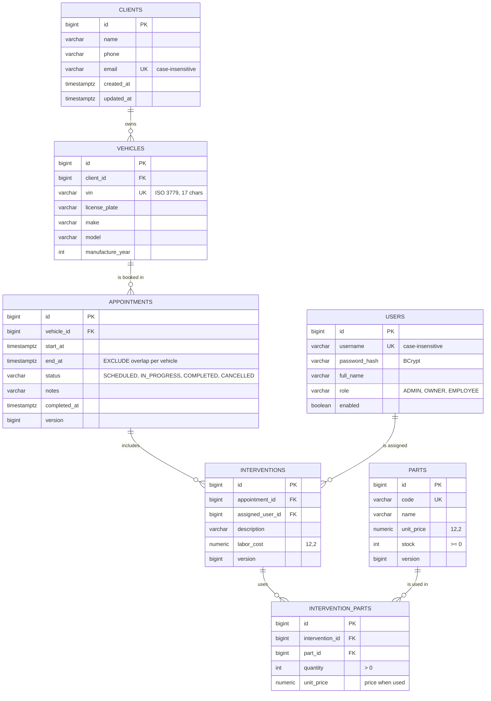

# Auto Service API

[](https://github.com/CerneaBogdanAndrei/auto-service-api/actions/workflows/ci.yml)


REST API for running a car repair shop: clients and their vehicles, appointments, the work done
during an appointment (interventions) and the parts inventory it consumes, plus revenue reporting.

It is the backend port of a desktop application I originally built with Java Swing, JDBC and MySQL.
The focus is on correctness under real conditions: business rules enforced in the service layer and
backed by database constraints, concurrency-safe stock handling, role-based security, and a test
suite that runs against a real PostgreSQL.

## Contents

- [Features](#features)
- [Tech stack](#tech-stack)
- [Quick start](#quick-start)
- [Data model](#data-model)
- [API overview](#api-overview)
- [Business rules](#business-rules)
- [Errors](#errors)
- [Testing](#testing)
- [Architecture decisions](#architecture-decisions)
- [Project structure](#project-structure)

## Features

- **Clients, vehicles and parts** — CRUD with paging, sorting and filters (vehicles by client, parts below a stock threshold).
- **Appointments** — scheduling without overlaps or past dates, a status lifecycle, and a cost breakdown.
- **Interventions** — work assigned to an employee; using parts takes them from stock transactionally.
- **Revenue report** — total and per-month revenue of completed appointments.
- **Security** — stateless JWT login and three roles (ADMIN, OWNER, EMPLOYEE). Employees only see and change their own work.
- **Uniform errors** — RFC 9457 Problem Details with a machine-readable `code` for every error, including 401 and 403.

## Tech stack

| Area          | Choice                                                                         |
|---------------|--------------------------------------------------------------------------------|
| Language      | Java 21                                                                        |
| Framework     | Spring Boot 3.5 (Web, Data JPA / Hibernate, Validation, Security, Actuator)    |
| Security      | Spring Security OAuth2 Resource Server, HS256 JWT (Nimbus), BCrypt             |
| Database      | PostgreSQL 16, schema managed by Flyway (`ddl-auto=validate`)                  |
| Mapping       | MapStruct (entities ↔ DTOs), Java records for every DTO, Lombok for entities   |
| API docs      | springdoc-openapi (Swagger UI)                                                 |
| Testing       | JUnit 5, Mockito, MockMvc, Testcontainers, ArchUnit, JaCoCo                    |
| Delivery      | Multi-stage Dockerfile, Docker Compose, GitHub Actions                         |

## Quick start

Requirements: Docker. (Java 21 is only needed to build or test outside Docker.)

```bash
# JWTs are signed with a secret that is never stored in the repository: generate one locally
echo "JWT_SECRET=$(openssl rand -base64 48)" > .env

docker compose up --build
```

| What            | URL                                          |
|-----------------|----------------------------------------------|
| Swagger UI      | http://localhost:8080/swagger-ui.html        |
| OpenAPI JSON    | http://localhost:8080/v3/api-docs            |
| Health          | http://localhost:8080/actuator/health        |

Log in with `POST /api/auth/login`, then click **Authorize** in Swagger UI and paste the `accessToken`.
Every request is also ready to run in [`http/auto-service.http`](http/auto-service.http) (IntelliJ HTTP Client).
Each login stores its token, and each create stores the new id for the next requests.

### Development credentials

These users are created by a Flyway seed that only the `dev` and `test` profiles load
(`classpath:db/seed`), so they never exist in other environments.

| Username   | Password       | Role     |
|------------|----------------|----------|
| `admin`    | `Admin123!`    | ADMIN    |
| `owner`    | `Owner123!`    | OWNER    |
| `employee` | `Employee123!` | EMPLOYEE |

### Configuration

All settings come from environment variables (see [`.env.example`](.env.example)):

| Variable               | Default (dev profile)  | Notes                                               |
|------------------------|------------------------|-----------------------------------------------------|
| `JWT_SECRET`           | — (required)           | ≥ 32 bytes; the app refuses to start otherwise      |
| `JWT_ACCESS_TOKEN_TTL` | `PT1H`                 | ISO-8601 duration                                   |
| `DB_URL`               | local PostgreSQL       | `DB_USERNAME` / `DB_PASSWORD` alongside             |
| `BUSINESS_TIME_ZONE`   | `Europe/Bucharest`     | Defines "a day" and "a month" for filters/reports   |
| `API_DOCS_ENABLED`     | `true`                 | Set to `false` to hide Swagger in production        |

To run the API from the IDE instead: `docker compose up postgres`, then start the application with
the `dev` profile and `JWT_SECRET` set.

## Data model



Every foreign key is `ON DELETE RESTRICT`, so history is never deleted implicitly. The only exception is
an intervention's own part lines, which are deleted with the intervention. Every table except
`intervention_parts` also has `created_at` / `updated_at` audit columns. The schema lives in
[`V1__init_schema.sql`](src/main/resources/db/migration/V1__init_schema.sql).

## API overview

All endpoints are under `/api` and require `Authorization: Bearer <token>`, except login.

| Resource            | Endpoints                                                                                                  | ADMIN | OWNER | EMPLOYEE        |
|---------------------|------------------------------------------------------------------------------------------------------------|:-----:|:-----:|:---------------:|
| Auth                | `POST /auth/login`, `GET /auth/me`                                                                         | ✓     | ✓     | ✓               |
| Users               | `GET/POST /users`, `GET/PUT/DELETE /users/{id}`, `PUT /users/{id}/password`                                | ✓     |       |                 |
| Clients             | `GET/POST /clients`, `GET/PUT/DELETE /clients/{id}`                                                        | ✓     | ✓     | read            |
| Vehicles            | `GET/POST /vehicles?clientId=`, `GET/PUT/DELETE /vehicles/{id}`                                            | ✓     | ✓     | read            |
| Parts               | `GET/POST /parts?stockBelow=`, `GET/PUT/DELETE /parts/{id}`                                                | ✓     | ✓     | read            |
| Appointments        | `GET/POST /appointments?from=&to=&status=&vehicleId=`, `GET/PUT/DELETE /appointments/{id}`, `PATCH /appointments/{id}/status` | ✓ | ✓ |        |
| Interventions       | `GET /interventions?appointmentId=&assigneeId=`, `GET/PUT /interventions/{id}`, `POST/DELETE /interventions/{id}/parts[/{partId}]` | ✓ | ✓ | own only |
|                     | `POST /interventions`, `DELETE /interventions/{id}`, reassigning                                           | ✓     | ✓     |                 |
| Reports             | `GET /reports/revenue?from=&to=`                                                                           | ✓     | ✓     |                 |

- **Lists:** paged with `page`, `size` (default 20, max 100) and `sort=field,asc|desc`. The response has the shape
  `{"content": [...], "page": {"size", "number", "totalElements", "totalPages"}}`.
- **Times:** ISO-8601 instants. Date filters (`from`, `to`) are whole days in the shop's time zone.
- **Money:** amounts are in RON with two decimals.

## Business rules

Rules live in the service layer and are unit-tested. Database constraints back them up, so
concurrent requests cannot break them either.

**Appointments**
- They cannot start in the past.
- Two non-cancelled appointments of the same vehicle cannot overlap. Intervals are half-open, so back-to-back bookings are fine.
- Status flow: `SCHEDULED → IN_PROGRESS → COMPLETED` and `SCHEDULED → CANCELLED`. Any other transition returns 409. Completion records `completed_at`.
- Only `SCHEDULED` appointments can be rescheduled. Only `SCHEDULED` or `CANCELLED` ones can be deleted.
- Total cost = labour + Σ(quantity × unit price), computed with `BigDecimal`.

**Interventions and stock**
- Interventions and their parts can change only while the appointment is `IN_PROGRESS`. Completed work is frozen.
- Using parts takes them from stock all-or-nothing. If any part lacks stock, the response is 409 and nothing changes.
- Removing a part, or deleting the intervention, returns the parts to stock.
- A part keeps the unit price it had when it was first used, so later catalogue price changes do not alter past costs.
- The assignee must be an active employee. Employees work only on their own interventions and cannot reassign them.

**Deletion and integrity**
- A vehicle with any appointment cannot be deleted.
- A client cannot be deleted while any of their vehicles has an appointment. Vehicles with no history are deleted together with the client.
- A part used by any intervention cannot be deleted.
- A user with assigned interventions cannot be deleted; disable the account instead.
- An administrator cannot delete, disable or demote their own account.
- Client emails, usernames, VINs and part codes are unique. Emails and usernames are compared case-insensitively.

**Revenue report:** an appointment counts in the month it was completed, in the shop's time zone. Every month of the range is listed, with 0 when there was no revenue.

## Errors

Every error is an [RFC 9457](https://www.rfc-editor.org/rfc/rfc9457) Problem Detail
(`application/problem+json`) with a stable `code`:

```json
{
  "type": "about:blank",
  "title": "Conflict",
  "status": 409,
  "detail": "Insufficient stock for part OIL-5W30: requested 4, available 3.",
  "instance": "/api/interventions",
  "code": "INSUFFICIENT_STOCK",
  "partId": 2,
  "requested": 4,
  "available": 3,
  "timestamp": "2026-11-23T18:42:07.123Z"
}
```

Validation errors (400) add `"errors": [{"field": "...", "message": "..."}]`. Unexpected errors return a
generic 500 and are logged; internals (SQL, stack traces) are never sent to the client.

| Status | Codes                                                                                                                                                                                       |
|--------|---------------------------------------------------------------------------------------------------------------------------------------------------------------------------------------------|
| 400    | `VALIDATION_FAILED`, `MALFORMED_REQUEST`, `INVALID_PARAMETER`                                                                                                                               |
| 401    | `UNAUTHORIZED` (missing, invalid or expired token; with `WWW-Authenticate: Bearer`), `INVALID_CREDENTIALS`                                                                                  |
| 403    | `ACCESS_DENIED`                                                                                                                                                                             |
| 404    | `RESOURCE_NOT_FOUND`                                                                                                                                                                        |
| 409    | `APPOINTMENT_IN_PAST`, `APPOINTMENT_OVERLAP`, `INVALID_STATUS_TRANSITION`, `APPOINTMENT_NOT_MODIFIABLE`, `APPOINTMENT_NOT_IN_PROGRESS`, `INSUFFICIENT_STOCK`, `INVALID_ASSIGNEE`, `CLIENT_HAS_APPOINTMENTS`, `VEHICLE_HAS_APPOINTMENTS`, `PART_IN_USE`, `USER_HAS_INTERVENTIONS`, `OWN_ACCOUNT_PROTECTED`, `EMAIL_ALREADY_EXISTS`, `VIN_ALREADY_EXISTS`, `PART_CODE_ALREADY_EXISTS`, `USERNAME_ALREADY_EXISTS`, `CONCURRENT_MODIFICATION`, `DATA_INTEGRITY_VIOLATION` |
| other  | `METHOD_NOT_ALLOWED`, `NOT_ACCEPTABLE`, `UNSUPPORTED_MEDIA_TYPE`, `INTERNAL_ERROR`                                                                                                          |

## Testing

```bash
./mvnw verify    # needs a running Docker daemon (Testcontainers)
```

| Suite                            | Runs with | What it covers                                                                                   |
|----------------------------------|-----------|--------------------------------------------------------------------------------------------------|
| Unit tests (`*Test`, 211)        | Surefire  | Every service with Mockito, including every error path; state machine; cost calculator; validators; error handler |
| Integration tests (`*IT`, 119)   | Failsafe  | Every controller against PostgreSQL 16 in Testcontainers: happy path, 400, 401, 403 per role, 404, 409 |
| End-to-end (`FullWorkflowIT`)    | Failsafe  | Real HTTP: login → client → vehicle → appointment → intervention with parts → completion → stock, cost and revenue |
| Architecture (`ArchitectureTest`)| Surefire  | ArchUnit rules that fail the build when the design drifts                                        |

Highlights:
- **Concurrency.**
  - 8 parallel bookings of the same slot produce exactly one appointment. The other 7 passed the service check at the same time and were rejected by the PostgreSQL `EXCLUDE` constraint.
  - 10 parallel uses of a part with stock 5 succeed exactly 5 times, and the stock ends at 0.
- **No N+1.** List endpoints are checked with Hibernate statistics. Without the entity graph, listing 5 vehicles takes 7 queries; with it, at most 2.
- **Real transactions.** Each test starts from an emptied database (`TRUNCATE`) instead of rolling back, so commits and rollbacks are the real ones.
- **Coverage gate.** JaCoCo fails the build if any `*Service` class drops below 80% line coverage from unit tests alone. Currently:
  - the service layer is at 99.0% from unit tests alone;
  - the whole application is at 96.6% of lines (81.8% of branches) with integration tests included.

  Reports are generated in `target/site/jacoco/` (all tests) and `target/site/jacoco-unit/` (unit tests only). CI publishes both and shows a summary on each run.

## Architecture decisions

1. **Package by feature, with dependencies in one direction.** Each feature (`client`, `vehicle`, `appointment`, …) holds its controller, service, repository, mapper and DTOs. Dependencies only point one way, for example `intervention → appointment → vehicle → client`, and ArchUnit fails the build on cycles. When a feature must read data owned by a feature that depends on it, it uses a native query instead of a code dependency. For example, an appointment's cost reads intervention rows directly.
2. **Service-layer rules, database-level guarantees.** Every rule is checked in a service, with a clear 409. The database enforces the same invariants: an `EXCLUDE` constraint for overlapping appointments, `CHECK (stock >= 0)`, unique indexes and `RESTRICT` foreign keys. A request that slips past a check under concurrency still gets the same specific error code, not a generic 500.
3. **Explicit locking for stock.** Stock changes lock rows in a fixed order: the appointment `FOR SHARE`, then the intervention `FOR UPDATE`, then the parts `FOR UPDATE` in id order. This prevents deadlocks and stops "complete appointment" and "use part" from interleaving. All quantities are validated before any change, and `@Version` guards edits against lost updates.
4. **Stateless security without custom crypto.** JWTs are issued and verified with Spring Security's resource server support (Nimbus, HS256). The secret exists only in the environment and is validated at startup. Who may call an endpoint is declared with `@PreAuthorize` next to it, and ArchUnit requires one on every endpoint; who may touch which record is checked in the services. Trade-off: tokens are short-lived (1 h) and cannot be revoked before they expire.
5. **Money and time are first-class.** Amounts are `BigDecimal` / `NUMERIC(12,2)`, and a part's price is recorded when it is used. Timestamps are stored in UTC (`timestamptz`). Days and months follow a configurable shop time zone, and a single injectable `Clock` makes time-based rules (no past appointments, model years, token expiry) testable.
6. **Schema owned by migrations; no entities over the wire.** Flyway owns the schema and Hibernate only validates it. Controllers exchange records mapped by MapStruct and never JPA entities, which ArchUnit enforces. `open-in-view` is disabled, so lazy loading cannot leak into the web layer.

## Project structure

```
src/main/java/io/github/cerneabogdanandrei/autoservice
├── auth/          login, JWT issuing/verification, security configuration
├── user/          user management (ADMIN)
├── client/        clients
├── vehicle/       vehicles, VIN and model-year validation
├── part/          parts inventory, row-level stock locking
├── appointment/   scheduling, status lifecycle, cost calculation
├── intervention/  work and part usage, ownership rules
├── report/        revenue report (SQL aggregation)
└── common/        errors (Problem Details), auditing, security primitives, time, config
src/main/resources/db/migration   Flyway schema (all environments)
src/main/resources/db/seed        development users (dev and test profiles only)
http/auto-service.http            every endpoint, ready to run
```
